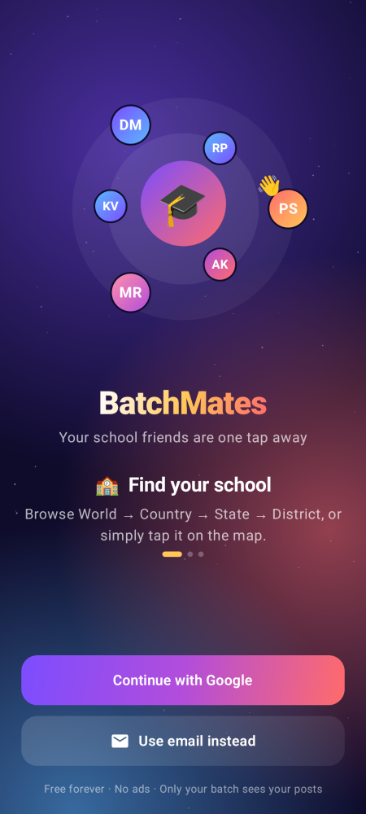
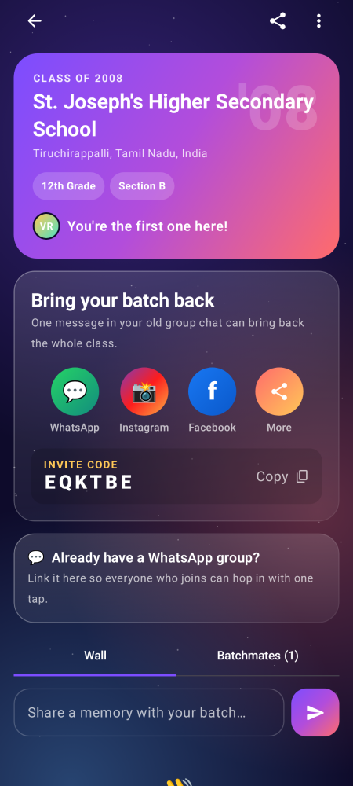
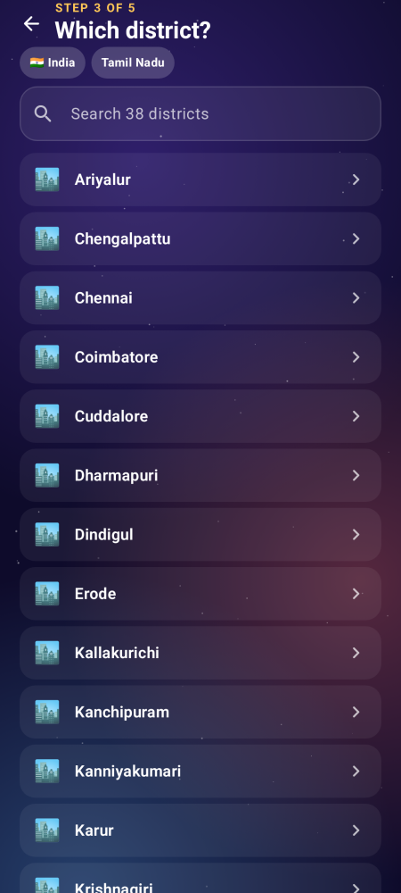
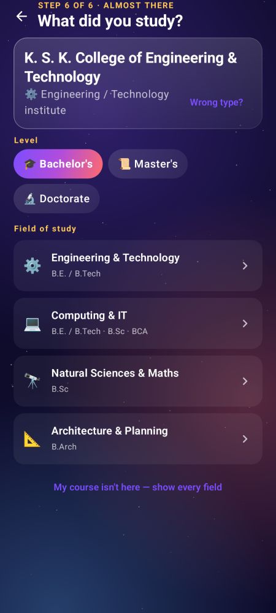
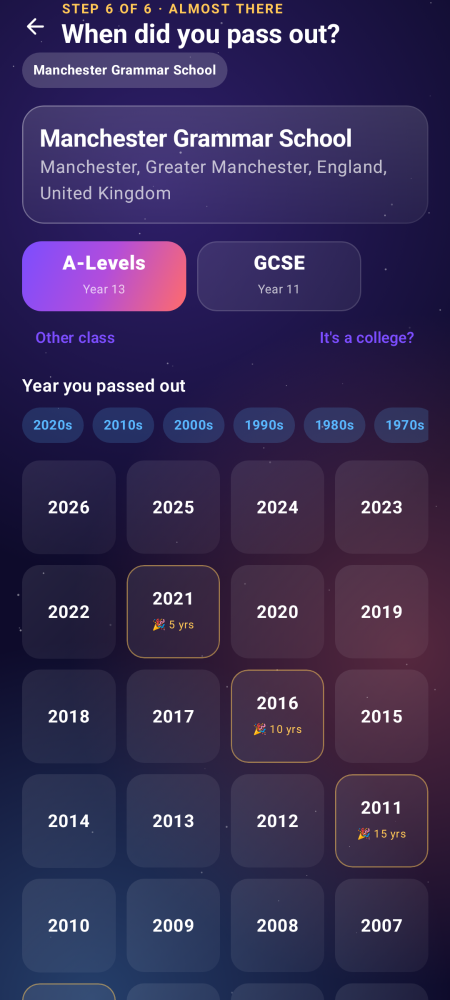
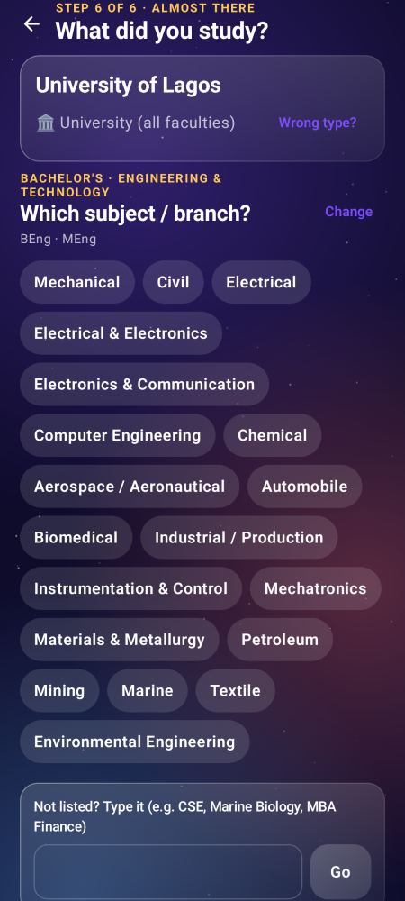

# 🎓 BatchMates — reunite with your school friends

An Android app (Kotlin + Jetpack Compose) that helps people find their old school,
their batch (10th / 12th, pass-out year), and their section, and then pull everyone back
in through WhatsApp, Instagram and Facebook invites.

**Running cost: ₹0 / $0.** All services used are free tiers or open data (details below).

<p>
        
</p>

*(Rendered from the real Compose screens with `./gradlew recordPaparazziDebug`.)*

---

## The user journey

| # | Screen | What happens |
|---|--------|--------------|
| 1 | **Welcome** | Animated hero with orbiting classmates. *Continue with Google* (one tap, Credential Manager) or *Use email* (sign in / create account / forgot password). |
| 2 | **Home** | Big **"Where did you study?"** card with two paths: **Browse places** or **Pick on map**. A field for an **invite code**. List of **My batches**. |
| 3 | **Browse** | World → **Country** (your country is suggested first) → **State** → **District** → **Town / village** (type-ahead, e.g. "kumb" → Kumbakonam, or one-tap chips of the district's towns) → **School**, nearest first with each school's own town and distance. Every list has search. Each step also has "Not listed? Type it" and "Skip" so nobody gets stuck. |
| 3b | **Map** | Free OpenStreetMap map. Schools appear as 🎓 pins once you zoom in. Search by name, use *My location*, tap a pin → "This is my school". **Long-press** anywhere → create a missing school at that spot. |
| 3c | **Add school** | If the school is not on any map, create it under its town. A **duplicate guard** compares the distinctive words of the name ("Vallalar" = "Vallalar Hr. Sec. School" = "Vallalar HSS") and the map pin against every known school nearby, and asks "Is it one of these?" before creating. Picking an existing school saves the typed name as an **alias**, so the next person searching that name finds it. |
| 3d | **Schools vs colleges, worldwide** | Results are split into **Schools** and **Colleges** tabs. The model follows UNESCO's **ISCED** standard (levels) and **ISCED-F** (fields of study), with each country's own names on top. "College" is read per country: Eton College, a Spanish *colegio* and a French *collège* are schools; a US community college is not. |
| 3e | **School stages in local terms** | 26 school systems: India 10th/12th, US elementary/middle/high school, UK GCSE/A-Levels, Germany Abitur, France Brevet/Bac, Spain & Latin America Secundaria/Bachillerato, Brazil Ensino Médio, Singapore PSLE/O/A-Level, West Africa JSS3/SSS3 (WASSCE), East Africa Form 4/6, South Africa Matric, East Asia junior/senior high, Gulf Grade 12, and more. School names are read in many languages (Grundschule, Lycée, Liceo, Primaria…). Curriculum beats geography: an "Indian School" in Dubai gets 10th/12th, a "British School" gets GCSE/A-Levels. |
| 4c | **Course (colleges)** | Batches already at this college first, then **Level** (Certificate/Diploma, Associate, Bachelor's, Master's, Doctorate) → **Field** (12 ISCED-F fields) → **Subject**, with local degree names as hints (B.E./B.Tech, BA/BS, BSc (Hons), Licence, Grado…). 19 institution types limit what appears: an engineering institute shows Engineering, Computing, Sciences, Architecture and MBA, never Arts, Medicine or a BBA; a dental school shows only Dentistry. "CSE", "Computer Science and Engineering" and "computer science" join one group. Colleges default to "Whole batch". |
| 4 | **Batch** | Pick **10th** or **12th**, then the pass-out **year** (grid with decade jump chips). Years that already have classmates glow and show "👥 12". |
| 5 | **Section** | Big A–H tiles (tiles with people pulse and show "12 here") plus a free-text field for streams like *Bio-Maths* or *Commerce*. **Join** → confetti 🎉 |
| 6 | **Batch page** | Class-of-'XX header with faces of members. **Invite** buttons: WhatsApp, Instagram, Facebook, More — plus a 6-letter **invite code** and link. Link your existing **WhatsApp group** so new joiners hop in with one tap. A **Wall** for memories and a **Batchmates** list. |

Invite links look like `https://<your-project>.web.app/j/K7QM2X`. Tapping one opens the app
(or the landing page with the code and a download button) and joins the batch automatically
after sign-in.

---

## Try it right now (Demo mode)

The app builds and runs **without any setup**. If no Firebase config is present it runs in
**Demo mode**: sign-in is simulated and batches live in memory with a few sample classmates,
while countries, states, districts, schools and the map are real.

```bash
cd batchmates
./gradlew assembleDebug            # APK: app/build/outputs/apk/debug/app-debug.apk
```

Or push to GitHub: the **BatchMates Android build** workflow builds the APK for free and
attaches it to the run as an artifact (`batchmates-apk`).

---

## Go live (about 15 minutes, still free)

1. **Firebase project** – go to <https://console.firebase.google.com>, create a project
   (stay on the free **Spark** plan; no card needed).
2. **Android app** – add an Android app with package `com.batchmates.app`.
   Add your SHA-1 fingerprint (`./gradlew signingReport`) – needed for Google sign-in.
3. **Authentication** → Sign-in method → enable **Google** and **Email/Password**.
4. **Firestore** → Create database (production mode, region close to your users).
5. Download **google-services.json** into `batchmates/app/` (it is git-ignored).
   For CI builds, paste its contents into a GitHub secret named `GOOGLE_SERVICES_JSON`.
6. **Rules + invite page** (needs the free Firebase CLI: `npm i -g firebase-tools`):
   ```bash
   cd batchmates/firebase
   firebase login
   firebase use --add            # pick your project
   firebase deploy --only firestore:rules,hosting
   ```
7. Put your hosting domain in `gradle.properties` → `batchmates.inviteHost=<project>.web.app`
   and set the download link in `firebase/public/index.html` (`id="get"`).
8. (Optional) To make invite links open the app with no chooser, add
   `firebase/public/.well-known/assetlinks.json` with your signing certificate SHA-256
   (Play Console → App integrity shows the exact file).

Build again – the app now uses real accounts and a shared database.

---

## Why it costs nothing

| Need | Choice | Free allowance |
|------|--------|----------------|
| Login (Gmail + email) | Firebase Authentication | Unlimited Google + email/password sign-ins |
| Database + live updates | Cloud Firestore (Spark) | 50k reads, 20k writes per day, 1 GB stored |
| Invite landing page | Firebase Hosting | 10 GB storage, 360 MB/day transfer |
| Map | OpenStreetMap tiles via osmdroid | Free (fair use, with attribution) |
| Districts | Bundled for all of India (800, from Wikidata, CC0); other countries via OpenStreetMap Overpass | Offline / free |
| Schools | Photon (fast OpenStreetMap search) + Overpass, merged; searched around the district centre | Free (fair use); cached on the phone for 2 weeks |
| School search / address lookup | Nominatim | Free, max 1 request/second (the app enforces this) |
| Countries + states | Bundled file (countries-states-cities-database, ODbL) | Offline, 77 KB |
| APK builds | GitHub Actions | Free for public repos, 2,000 min/month for private ones |

**Why not Google Maps / Places?** The Google Maps SDK needs a billing account and Places
search is charged per request, which breaks the "no cost" goal. OpenStreetMap has very good
school coverage in India and elsewhere, and where a school is missing, alumni can add it.

**Only paid item:** publishing on Google Play is a one-time USD 25 developer fee. Until then
you can share the APK directly.

**When you outgrow the free tier** (thousands of active users a day) Firestore moves to
pay-as-you-go at a few cents per 100k reads – costs stay tiny, and you can add a
small Overpass/Nominatim cache server later if you need one.

---

## Architecture (for developers)

```
app/src/main/java/com/batchmates/app
├── BatchMatesApp.kt          AppContainer: picks Firebase or Demo backends
├── MainActivity.kt           splash, edge-to-edge, invite deep links, navigation
├── data/
│   ├── Models.kt             School, Region, Grade, BatchKey, Group, Member, Message
│   ├── Repositories.kt       AuthRepository / ReunionRepository interfaces
│   ├── firebase/             Firebase Auth (Credential Manager) + Firestore (transactions)
│   ├── demo/                 In-memory versions for Demo mode
│   └── geo/                  Bundled regions, Overpass + Nominatim with on-disk cache
├── ui/
│   ├── theme/                brand colours, typography
│   ├── components/           aurora background, glass cards, gradient buttons, avatars, confetti
│   ├── welcome/ home/ finder/ group/   screens + ViewModels
└── util/                     invite codes, WhatsApp/Instagram/Facebook sharing
firebase/                     Firestore rules, hosting landing page for invite links
```

* **Firestore layout:** `schools/{id}`, `groups/{schoolId_grade_year_section}` with
  `members/` and `messages/` sub-collections, `codes/{inviteCode}`, `users/{uid}/groups/`.
  A batch's id is deterministic, so two friends picking the same school, year and section
  always land in the same group – no duplicates.
* Joining is a Firestore **transaction** (creates school + group + member atomically and
  keeps counts consistent). Security rules let only members read and post on a wall.
* Stack: Kotlin 2.0, Compose (Material 3), Navigation Compose, ViewModel + StateFlow,
  Firebase BoM, Credential Manager, osmdroid, Coil. Min Android 8.0 (API 26), target API 35.

## Roadmap ideas
* Push notifications when a classmate joins (Firebase Cloud Messaging – free).
* Class photo album (Firebase Storage needs the Blaze plan; alternatives: share Google Photos albums).
* Reunion event planner with RSVP and date poll.
* Teachers directory and "Where are they now" profiles.
* More grades (8th, college batches) – just add values to `Grade`.

Map data © OpenStreetMap contributors (ODbL). Indian district list and centre points from Wikidata (CC0). School search by Photon (komoot). Country/state list © countries-states-cities-database (ODbL).
